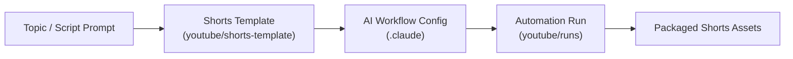

# Handy

[](https://developer.mozilla.org/en-US/docs/Web/JavaScript)
[](https://www.youtube.com/)
[](LICENSE)

**Handy** is a YouTube Shorts and workflow automation toolkit featuring repeatable templates, run logs, and AI-assisted scripts.

## Architecture



## Quickstart

```bash
git clone https://github.com/mukeshsarwa33-droid/Handy.git
cd Handy
ls -la youtube/shorts-template
```

## License

This project is licensed under the [MIT License](LICENSE).
